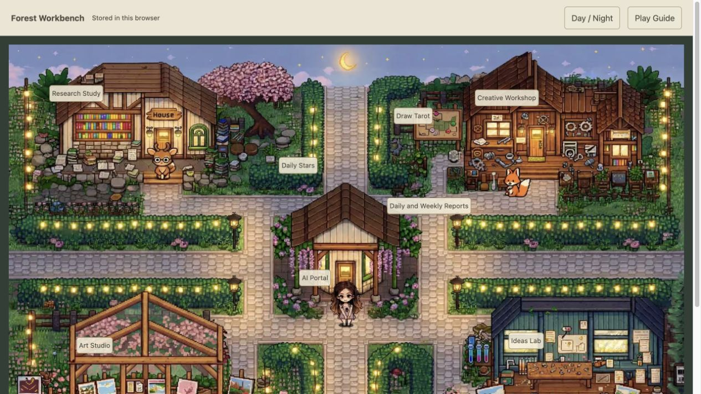
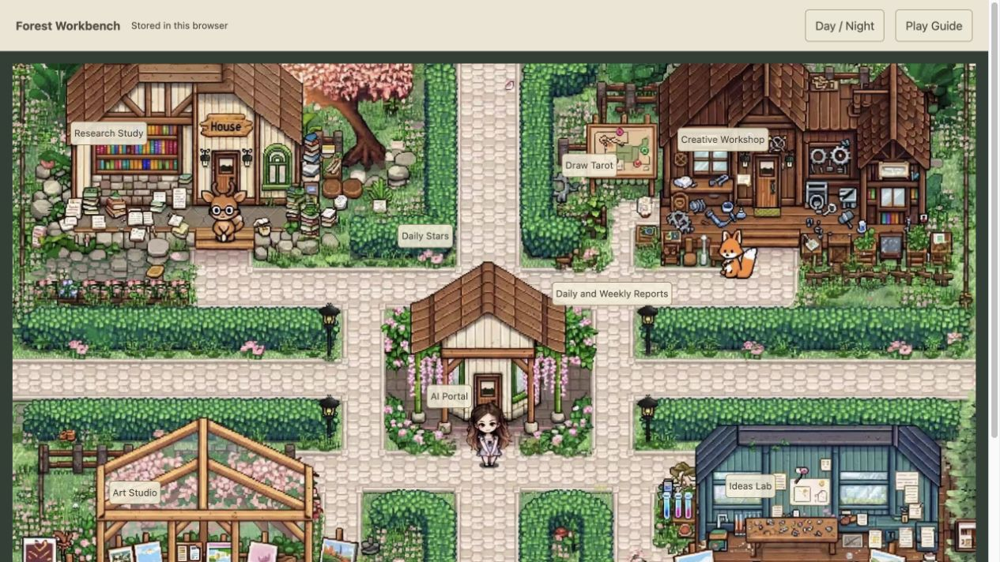
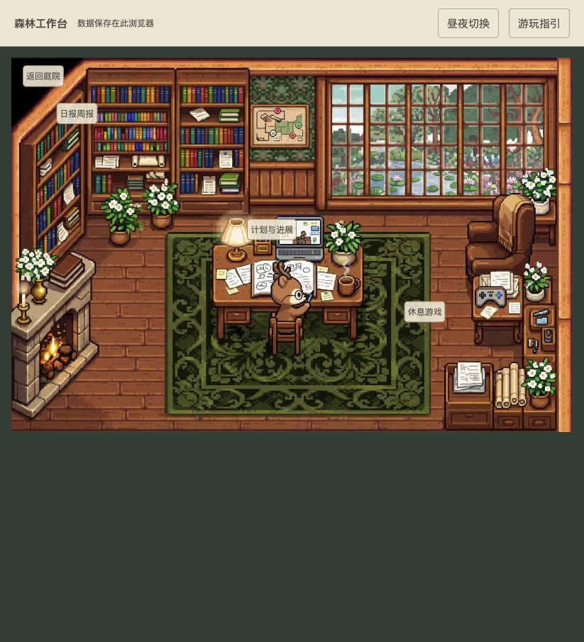
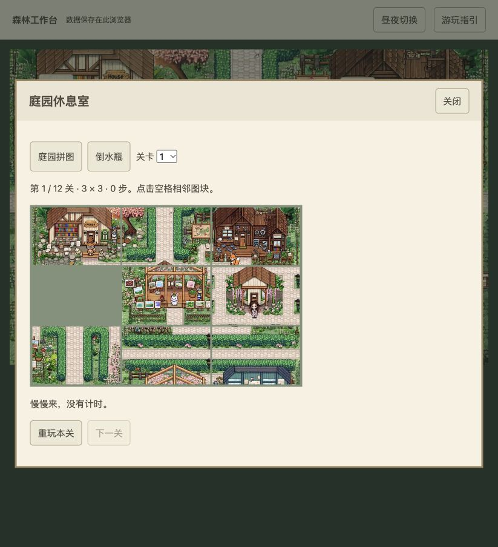
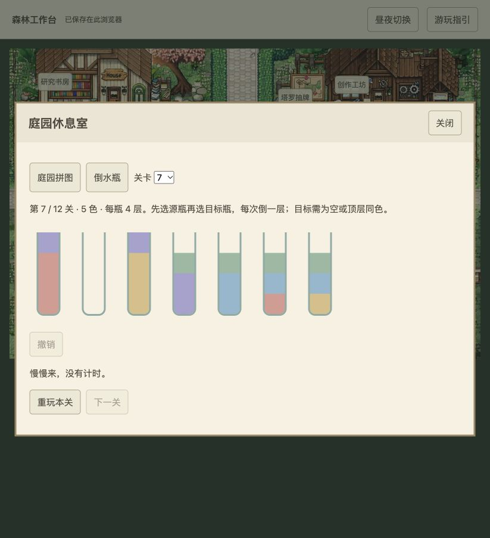
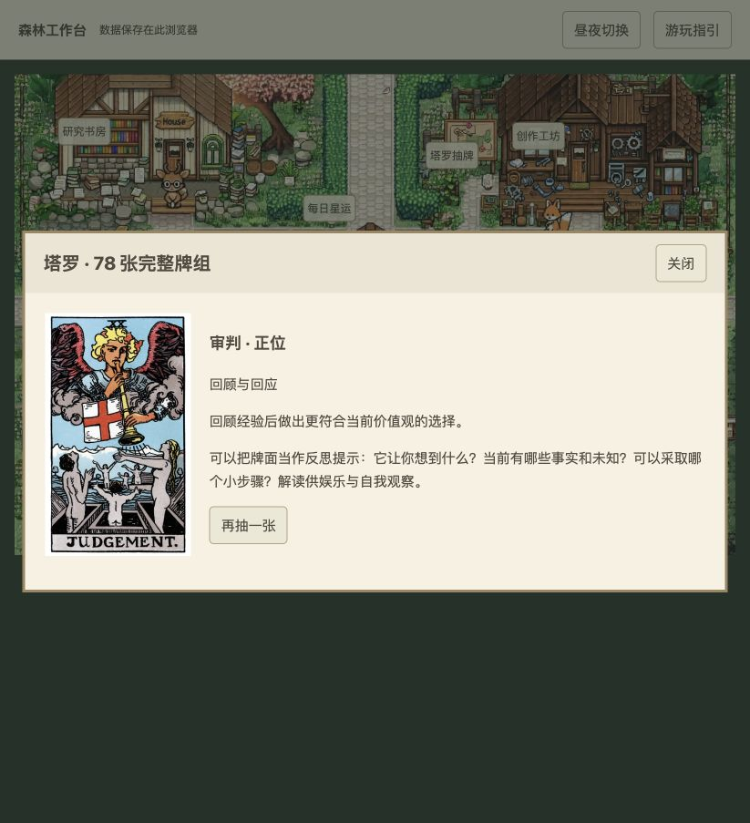
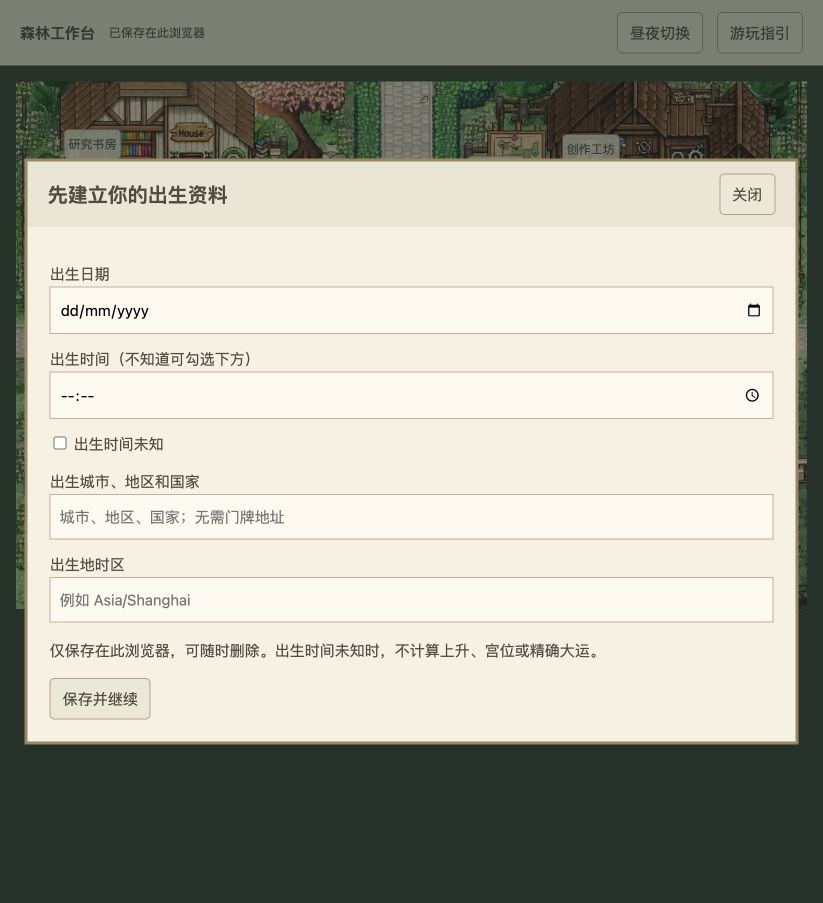

# Forest Workbench

> Open a little door. Start your day. Take a break by the pond.

A pixel-art home for your projects, plans, reports and AI tools - with a few small adventures between tasks. Includes a runnable starter and a reusable **Codex Skill** for building your own version.

[Get started](#move-in-in-three-minutes) · [Work portals](#your-work-one-garden-away) · [Play](#a-little-play-between-tasks) · [Install the Skill](#build-your-own-with-codex) · [Checks](https://github.com/s530han8e-rgb/gamified-workbench-skill/actions/workflows/check.yml)




## Your work, one garden away

Doors lead to project rooms. A signpost opens your reports. Objects in the garden carry the navigation, so work and breaks share one small world.

| Place | What it opens |
| --- | --- |
| Research Study, Creative Workshop, Art Studio, Ideas Lab | Separate spaces for plans, tasks and progress |
| Report signpost | Daily and weekly reports, organized by date with source notes |
| AI Portal | Links to ChatGPT and Codex |
| Lantern | Birth-profile setup and Vedic astrology configuration status |
| Hedge light | Illustrated tarot cards and upright/reversed readings |
| Pond | Garden Puzzle and Water Sort |
| Top bar | Day/night switch and a play guide |

Room notes, report text, source notes and selected levels save automatically in the current browser. Every room starts empty, ready for your own work.

### A small world to settle into

These are actual screenshots of the neutral starter, with no private documents or real project records.

| Daylight garden | A quiet study |
| --- | --- |
|  |  |

## A little play between tasks

### Garden Puzzle - 12 levels

Slide a tile next to the empty space and piece the garden back together. Levels 1-4 use **3 x 3** grids, 5-8 move to **4 x 4**, and 9-12 reach **5 x 5**. Select a level, replay it, or move on after completing it. Your selected level is remembered.

Every puzzle is scrambled through legal moves from a solved board. Grid size and scramble budget increase; the shortest solution can vary between randomly generated boards.

### Water Sort - 12 levels

Pick a source bottle, then a destination. Pour one layer into an empty bottle or onto the same top color. Finish with each color in its own full bottle.

Start with **2 colors and 3 layers**, then progress to **7 colors and 4 layers**. Undo a move, replay, select a level or continue after a win. Each board is generated backward from a solved state, retaining a legal solution for testing.

| Rebuild the garden | Put colors in their place |
| --- | --- |
|  |  |

### Tarot - all 78 cards, illustrated

The complete **22 Major Arcana and 56 Minor Arcana**, with card artwork, upright/reversed orientation, themes and reflective readings. Pause for a moment: what does the card bring to mind, and what deserves a second look?

### Vedic astrology - start with your birth profile

The first visit opens a form for **birth date, birth time, birth city/region/country and timezone**. No street address is needed. Unknown birth times can be marked explicitly. The profile stays in the current browser and can be deleted and re-entered.

**The public starter implements profile setup and storage; a general chart engine is not connected yet.** It shows a configuration message rather than producing personalized forecasts. An integration must supply coordinates, historical timezone handling and explicit sidereal/ayanamsa settings. An unknown birth time limits ascendant, houses and precise timing claims.

| Illustrated tarot | First-use birth profile |
| --- | --- |
|  |  |

Tarot and astrology are intended for entertainment and self-reflection.

## Move in in three minutes

You need Python 3 and a modern browser. No API key or frontend dependencies are required.

```bash
git clone https://github.com/s530han8e-rgb/gamified-workbench-skill.git
cd gamified-workbench-skill
python3 -m http.server 8080
```

Open **<http://localhost:8080/demo/>** and click a door or garden object. Use the local server: browsers can restrict ES Modules when opening `file://` directly.

## Build your own with Codex

The included `gamified-workbench-builder` Skill helps connect your workflow, storage and illustrated interactions.

```bash
mkdir -p ~/.codex/skills
cp -R gamified-workbench-builder ~/.codex/skills/
```

Try this request:

```text
Use $gamified-workbench-builder and the demo starter to build my workbench.
Define my work portals and rooms, then connect my own data.
Keep the progressive games, tarot and first-use birth-profile setup.
```

The Skill also guides source validation, report deduplication, save conflicts, backup/recovery, AI handoffs and cross-device architecture. These are implementation instructions, not backend features already present in the static starter. See [Architecture](gamified-workbench-builder/references/architecture.md), [Data contract](gamified-workbench-builder/references/data-contract.md) and [Review checklist](gamified-workbench-builder/references/review-checklist.md).

## What works today

| Feature | Public starter status |
| --- | --- |
| Garden, four rooms, manual day/night switch | Ready to run |
| Room notes, dated reports and source notes | Autosave in this browser |
| ChatGPT / Codex | External links; no automatic project submission |
| 78-card tarot, 12 puzzle levels, 12 water-sort levels | Playable |
| Vedic astrology | Birth-profile form ready; chart engine pending |
| Phone/desktop cloud sync, Notion, background imports | Requires your own backend and authorization |
| Independent character animation and full object lighting | Not included in this starter |

Browser storage is not a backup or cloud sync. Clearing browser data, changing devices or changing the site address does not migrate records. Connect backup and storage before using the starter for important work.

## Reuse the world. Keep your records private.

The public package contains neutral code, scene artwork, card images and empty workspaces. It does not ship the maintainer's project documents, chats, reports, attachments, birth profile, configuration or local paths. Screenshots also come from the neutral starter.

Keep real records outside the published source tree. `.gitignore` provides a basic exclusion list; review every release. See [Assets](demo/ASSETS.md) and [Safety and handoffs](gamified-workbench-builder/references/safety-and-handoffs.md).

The repository is publicly visible. Public visibility and an open-source license are separate decisions; no new code license or marketplace agreement is granted by this language update. Check asset-specific terms before redistribution.

## Checks

With Node.js 22 or later:

```bash
node --test tests/*.test.mjs
node scripts/check-release.mjs
```

GitHub Actions checks solvability, move rules, all card images, local documentation links, English-only source text and public-package boundaries. Browser review notes are in [Showcase and verification](docs/SHOWCASE.md).

```text
demo/                         Runnable neutral starter and artwork
gamified-workbench-builder/    Codex Skill and architecture references
docs/screenshots/             Actual English-interface screenshots
tests/                        Game and deck checks
scripts/                      Documentation and release checks
```

## Presentation references

The gallery and capability notes were inspired by [Trianon](https://github.com/qimingjiu/Trianon); the concise navigation by [RSSHub](https://github.com/DIYgod/RSSHub). This project uses its own pixel garden and implementation, without copying their interface code.
