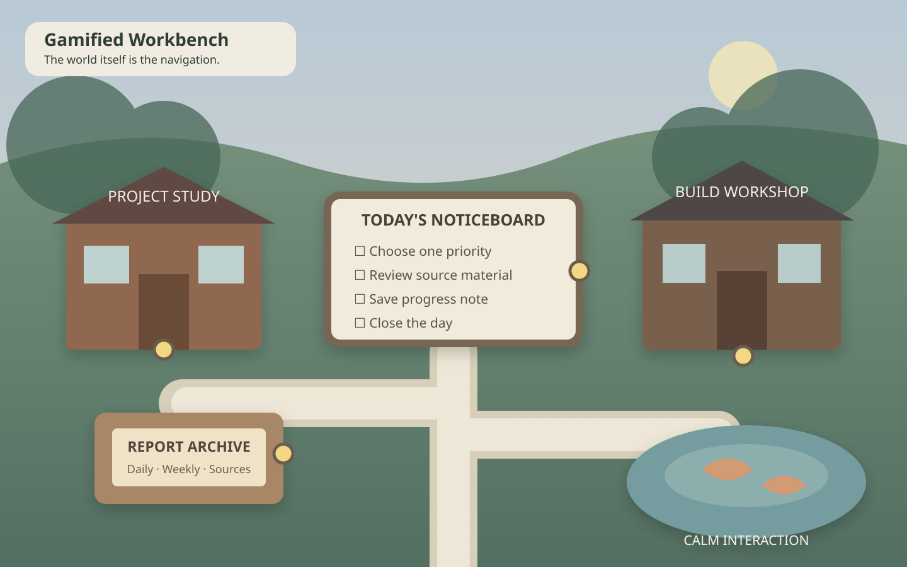
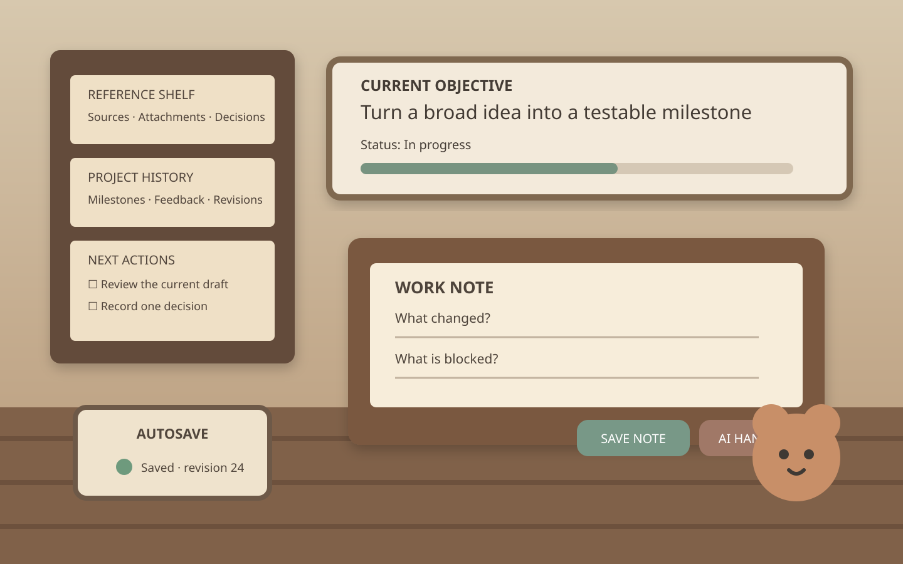
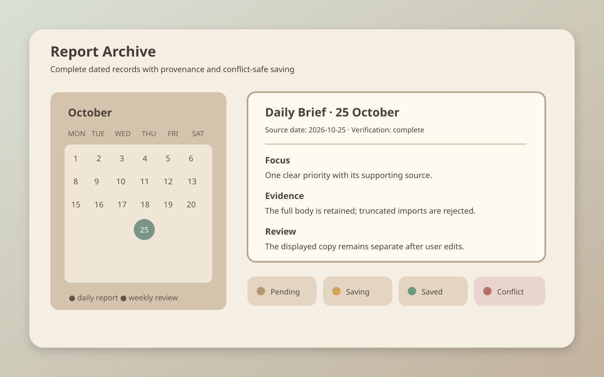
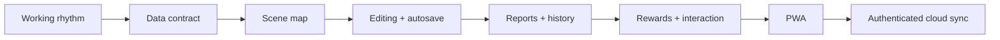
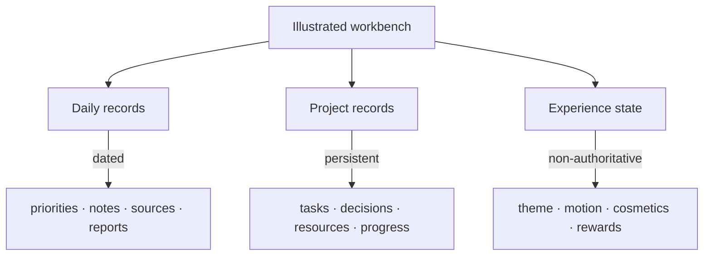

# Gamified Workbench Builder

> A reusable Codex skill for turning real projects, dated reports, and daily work into a calm, interactive game world—without hiding the underlying data model.



## What this repository provides

Most productivity dashboards begin with cards, sidebars, and charts. This skill begins with the user's working rhythm and turns it into a navigable world: a room can represent a project, a noticeboard can hold daily and weekly reports, a desk can open the current task, and a lamp or window can reveal quiet interactions without creating a second, disconnected dashboard.

The skill guides Codex through four connected design problems:

- **Information architecture:** daily records, long-running projects, sources, attachments, reports, and external handoffs.
- **World interaction:** rooms and objects act as navigation; animation communicates state instead of becoming visual noise.
- **Reliable persistence:** autosave states, revision checks, backups, recovery drafts, conflict handling, and deduplicated imports.
- **Delivery:** local-first prototypes, responsive PWA installation, authenticated cloud storage, and cross-device access.

The repository contains a framework only. It includes no personal journal, research subject, private project name, chat identifier, account, local path, or production data.

## Experience preview

These illustrations are deliberately generic mock screenshots. They demonstrate the interaction model rather than reproducing any private workbench.

### 1. The illustrated world is the navigation


Instead of placing a conventional menu under the artwork, meaningful objects carry the interface:

| Object | Example action | Data it may expose |
| --- | --- | --- |
| Study door | Open a project room | milestones, decisions, next action |
| Noticeboard | Open the dated archive | daily and weekly reports |
| Workshop desk | Open a build area | tasks, files, test status |
| Pond | Open a calm interaction | harmless experience state |
| Lantern | Toggle day/night presentation | theme preference only |

### 2. A room contains real project tools



A room should be more than a decorative modal. It can contain a current objective, progress history, resources, decisions, attachments, a task queue, and an approved AI handoff. The illustrated layer and the operational layer remain connected.

### 3. Saving and report history are explicit



Autosave must visibly distinguish `pending`, `saving`, `saved`, and `conflict`. Imported reports retain title, original date, complete body, provenance, verification status, and a content hash for deduplication.

## Install the skill

### Option A — copy the folder

Copy `gamified-workbench-builder` into your Codex skills directory:

```bash
mkdir -p ~/.codex/skills
cp -R gamified-workbench-builder ~/.codex/skills/
```

Restart Codex if the skill is not discovered immediately.

### Option B — install from Git

```bash
git clone https://github.com/s530han8e-rgb/gamified-workbench-skill.git
cp -R gamified-workbench-skill/gamified-workbench-builder ~/.codex/skills/
```

The skill remains available for normal automatic selection. It can also be invoked explicitly as `$gamified-workbench-builder`.

## Example requests

```text
Use $gamified-workbench-builder to design a calm, game-like research workbench.
Start from my daily workflow and project areas before styling the scene.
```

```text
Refactor this dashboard into an illustrated world.
Keep one canonical data model, preserve autosave and history,
and map each visible object to a meaningful action.
```

```text
Audit this gamified workbench before release.
Check every hotspot, mobile layout, report deduplication,
conflict recovery, reduced motion, and per-user authorization.
```

## Recommended build sequence



1. **Model the work.** Identify recurring daily actions, persistent projects, dated reports, source material, attachments, and external services.
2. **Define canonical records.** Do not create a duplicate task system when existing data can be referenced or imported.
3. **Map the world.** Give every interactive object a purpose and provide an optional guide listing all hotspots.
4. **Make editing safe.** Add autosave state, atomic writes, backups, recovery drafts, and explicit conflict handling.
5. **Add report history.** Preserve complete source text and dates; reject truncated imports; deduplicate by body hash.
6. **Add restrained play.** Rewards may reflect completed work, but project truth must never live only inside cosmetic state.
7. **Deliver progressively.** A local PWA is not phone sync. Cross-device use requires HTTPS hosting, authentication, server storage, and conflict handling.

## The three-state model



- **Daily records** are dated and reviewable.
- **Project records** persist across dates and hold authoritative work state.
- **Experience state** controls presentation and harmless game progress.

Keeping these layers separate prevents a visual reward system from overwriting or obscuring real work.

## Repository map

```text
gamified-workbench-skill/
├── README.md
├── docs/
│   └── screenshots/
│       ├── garden-overview.svg
│       ├── project-room.svg
│       └── daily-archive.svg
└── gamified-workbench-builder/
    ├── SKILL.md
    ├── agents/
    │   └── openai.yaml
    └── references/
        ├── architecture.md
        ├── data-contract.md
        ├── review-checklist.md
        └── safety-and-handoffs.md
```

The main `SKILL.md` contains the decision-making workflow. Supporting references are loaded only when the related architecture, persistence, safety, or review question arises.

## Core invariants

- One canonical record may appear in several views; several views must not silently become several sources of truth.
- Autosave never silently overwrites a conflict.
- Importers reject incomplete material and preserve user-edited copies.
- External AI actions require a visible handoff, approval boundary, and return path.
- Private content does not enter a public repository or client bundle.
- Animation remains calm, optional, readable, keyboard accessible, and touch accessible.
- A hosted write is authorized for the signed-in user; possession of a URL is not authorization.

## Definition of done

Before calling the workbench complete, verify observable behavior:

- every hotspot opens the intended target;
- touch and keyboard paths work;
- save and recovery survive reloads;
- duplicate imports do not duplicate records;
- imports do not overwrite edited records;
- day/night and reduced-motion modes remain legible;
- mobile layouts preserve core actions;
- server-side writes are authorized per user;
- backups can be restored;
- the interaction guide matches the current scene.

The full checklist is in [`references/review-checklist.md`](gamified-workbench-builder/references/review-checklist.md).

## Privacy boundary

This public repository intentionally contains only reusable structure and synthetic examples. When applying the skill to a real workbench:

1. keep private records outside the public source tree;
2. use templates or fixtures for demonstrations;
3. require authenticated storage for cloud persistence;
4. inspect screenshots, logs, archives, and build artifacts before publishing;
5. never treat a public front-end bundle as a secrets store.

## License and reuse

The skill is designed to be adapted. Before redistributing it, add the license that matches your intended reuse policy and verify that any visual assets you add are original or appropriately licensed.
